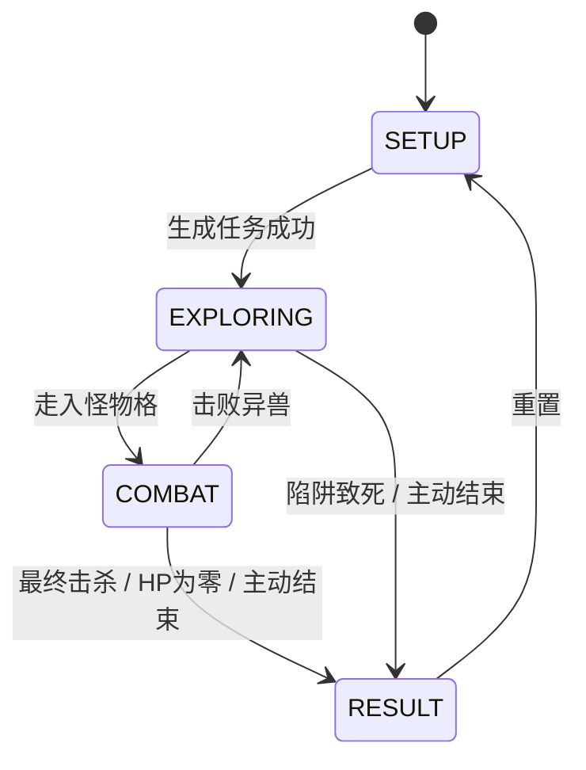

# AI技术策划试炼场（保留的策划模式）

一个用 **Streamlit + Plotly + Pandas** 构建的 10×10 策略沙盘。三栏分别展示角色与动态任务、网格关卡、回合战斗与图表。任务目标贯穿探索和战斗，结算后用同一局的轨迹、受击点和战斗日志生成 AI 复盘。

支持 DeepSeek 异步生成，以及无需 Key 的明确离线演示。ComfyUI 为可选扩展；不可用时展示标注来源的本地占位海报。

## 快速运行

需要 **Python 3.11+**。当前E盘环境的安装与缓存配置请先按根目录README执行。以下为常规安装示例：

Windows PowerShell：

```powershell
python -m venv .venv
.\.venv\Scripts\python.exe -m pip install -r requirements.txt
# 已有 .env 时保留它，不要覆盖真实配置。
Copy-Item .env.example .env
.\.venv\Scripts\python.exe run.py
```

macOS / Linux：

```bash
python3 -m venv .venv
.venv/bin/python -m pip install -r requirements.txt
# 已有 .env 时跳过下一行。
cp .env.example .env
.venv/bin/python run.py
```

打开 [http://127.0.0.1:8501](http://127.0.0.1:8501)。启动器会启动 FastAPI 和 Streamlit，按 Ctrl+C 关闭两个服务。默认只监听本机，不自动打开浏览器。

也可以在两个终端分别运行：

```bash
python -m uvicorn backend.main:app --host 127.0.0.1 --port 8000
python scripts/start_frontend.py --server.port 8501
```

展开左上角侧栏选择“策划试炼场”，使用左侧“离线演示”。无需 API Key、GPU、ComfyUI、Graphviz 或数据库。离线演示仍经过 FastAPI，必须启动后端。

## 玩一局

1. 设置开局血量比例、金币和地图随机种子，点击“生成任务”。
2. 任务目标固定为清除 6 只异兽，叙事、奖励、战术建议随玩家状态变化。低血量优先建议补给。生成任务后直接进入探索；三个分支是路线建议，不自动结算数值。
3. 点击地图上的四方向相邻格，或使用方向按钮移动。出生点为 (0,0)，坐标为 (x,y)，y 向下递增。不可对角走或跳格。
4. 遇到怪物自动打开右侧战斗面板；选择技能或等待。战斗中不能移动。击败敌人后继续探索。
5. 清除全部异兽胜利，HP 耗尽失败；“结束试验并结算”可提前结束。结算自动请求复盘，展示热力图与 DPS。可生成海报，导出整局 JSON、热力图 CSV 和 DPS CSV。
6. “重置试炼”回到准备状态，清空当前数据。运行中开局参数锁定，不改写历史。

状态保存在 **st.session_state.arena**，每个浏览器会话独立。页面内重跑不会重复攻击、发奖励或复盘；浏览器重载/会话失效会丢失本局，可先导出 JSON。地图随机种子只影响布局，AI 文字不保证可复现。

## 状态机与数值



零血量开局直接进入失败结算。每局最多 400 步 / 200 个战斗回合，达到上限自动结束试验。

| 项目 | 数值与策划含义 |
| --- | --- |
| 玩家 | HP 上限 100，MP 上限 40，ATK 20；金币上限 1,000,000 |
| 地图 | 10×10：空地 0、陷阱 1（12个）、怪物 2（6个）、补给 3（8个） |
| 陷阱 | 扣 8 HP，实际伤害不会超过剩余 HP；触发后清除 |
| 补给 | 恢复 25 HP / 12 MP，在上限内生效；触发后清除。出生点右方/下方各保留一个 |
| 异兽 | HP = 42 + (7x + 3y) % 13；ATK = 4 + (x + y) % 3；即 HP42–54 / ATK4–6 |
| 技能1·破阵重击 | round(ATK×1.8)，即36伤害；消耗12MP；冷却3个完整后续回合 |
| 技能2·潮汐回响 | round(ATK×0.7)，即14伤害；免费、恢复8MP；冷却1个完整后续回合 |
| 等待 | 恢复3MP，推进冷却；敌人仍然反击 |
| 结算顺序 | 玩家技能 → 冷却推进 → 敌人若存活则反击。击杀回合不反击 |
| 击杀收益 | 每只 +12金币；胜利后额外发任务金币、恢复HP、解锁物品，仅发一次 |
| 冷却重置 | 每场遭遇初始化技能冷却；HP、MP、金币沿整局继承 |

例：技能1 → 技能2 → 等待 → 技能2 → 技能1。两技能都不可用的回合属于技能真空期。MP不足也可能使技能不可用。

DPS 使用**策划模拟时间**：每回合 2 秒，不使用用户真实点击时间。实际伤害 = min(技能伤害, 敌方剩余HP)，排除过量伤害。实线是本回合伤害/2，虚线是本场累计实际伤害/本场秒数；图的横轴累积所有战斗回合，换敌人时本场平均重算。金色标记标注最高非零爆发点，灰色区间标注技能均不可用的等待回合；主动等待不冒充技能真空期。

受击热力图通过 Pandas 整理为 10×10 矩阵，按 **受击次数** 计数，包含陷阱和敌人反击。伤害量另保存在 hit_points，方便进一步分析。零受击图为零；未走区域不代表没有风险。

所有关键公式、冷却时序与伤害封顶规则均在 game/engine.py 中附策划注释。地图无障碍墙，所有位置都可达，但移动受相邻和战斗状态约束。

## 接入 DeepSeek

编辑 .env，然后重启服务：

```dotenv
DEEPSEEK_API_KEY=你的真实Key
DEEPSEEK_BASE_URL=https://api.deepseek.com
DEEPSEEK_MODEL=deepseek-flash
DEEPSEEK_TIMEOUT=60
```

模型名可按账号可用模型修改。Key 只在后端读取；不要提交 .env。左侧关闭“离线演示”后生成任务，任务与本局复盘均使用 DeepSeek。

后端通过 **httpx.AsyncClient** 异步请求 /chat/completions，使用 JSON 输出模式。Prompt 包含玩家血量比例、金币与 Pydantic Schema，地图和技能数值由本地代码决定。前置条件必须可满足，目标固定为6，三个分支唯一，奖励有上限。格式或数值错误会带校验反馈纠正重试一次；鉴权、限流、连接失败和超时均显示可读错误，真实模式不会自动改用离线结果。

复盘发送 battle_log、path、hit_points、dps_samples 与结算结果，要求返回 JSON advice，Pydantic 校验为 200 字以内。任务和复盘等待期间显示加载动画。结算复盘失败后可重试，不改变战斗数据。

任务 JSON 示例：

```json
{
  "name": "雾港六枚兽印",
  "description": "规划补给路线，逐个清除异兽。",
  "preconditions": {"min_hp": 0, "min_gold": 0},
  "target_monsters": 6,
  "rewards": {
    "gold": 80, "hp": 10,
    "item_name": "潮汐指挥徽章",
    "item_prompt": "silver tide command badge, fantasy game concept art"
  },
  "branches": [
    {"action": "accept", "title": "规划清剿路线", "description": "优先保证补给覆盖。"},
    {"action": "refuse", "title": "暂缓试炼", "description": "主动结束试验，检查路线。"},
    {"action": "befriend", "title": "拜访补给商", "description": "先走补给点，提高容错。"}
  ]
}
```

## ComfyUI 彩蛋

**backend/poster.py 的异步 generate_achievement_poster()** 复用现有 ComfyUI 客户端。结算海报按钮将任务的奖励物品名与英文提示词注入 API 工作流。失败或退出试验也可生成纪念图，物品奖励仍只在胜利时解锁。

1. 启动本地 ComfyUI：通常为 python main.py --listen 127.0.0.1 --port 8188。
2. 示例工作流是 SD1.5，需自行将兼容 checkpoint 放入 ComfyUI 的 models/checkpoints/。
3. 在 .env 设置实际模型名并重启 Demo：

```dotenv
COMFYUI_BASE_URL=http://127.0.0.1:8188
COMFYUI_WORKFLOW=workflows/reward_api.json
COMFYUI_CHECKPOINT=v1-5-pruned-emaonly.safetensors
COMFYUI_TIMEOUT=120
```

客户端提交 /prompt，异步轮询 /history/{prompt_id}，再通过 /view 读取图片。不存在服务、没有模型、工作流失败或超时均返回标注为“占位图”的本地 PNG 和原因。图片可以下载。成功生成的图片标注为“ComfyUI 生成”。

自定义工作流须从 ComfyUI 导出 **API 格式** JSON（不要使用 nodes/links 画布 JSON）；正向提示词含 {{prompt}}，模型名可含 {{checkpoint}}，至少有一个 SaveImage。支持自定义 SDXL/Flux 工作流，需对应模型与节点，本项目不下载模型。超时后的 ComfyUI 任务可能仍在队列，本项目不取消其它用户任务。

## 接口与目录

交互文档：[http://127.0.0.1:8000/docs](http://127.0.0.1:8000/docs)。

| 方法 | 路径 | 请求及响应 |
| --- | --- | --- |
| GET | /health | AI/ComfyUI 配置与超时信息 |
| POST | /api/arena/task | {hp_ratio, gold, mode} → 任务 JSON |
| POST | /api/arena/review | {battle_log, path, hit_points, dps_samples, result, mode} → {review} |
| POST | /api/arena/poster | 任务 rewards → Base64图片、source、notice |

mode 为 demo 或 deepseek，默认 deepseek。原任务树 API 及其相关测试保留，首页使用沙盘 API。

```text
sandbox_app.py          三栏 Streamlit 策划页面与 session_state 生命周期
game/engine.py          地图、移动、技能、状态迁移、奖励结算
game/contracts.py       AI 任务及请求校验合同
game/charts.py          Pandas 聚合、Plotly 地图/热力图/DPS
backend/arena_ai.py      DeepSeek 异步任务与复盘、显式离线模式
backend/arena_api.py     新沙盘 FastAPI 路由
backend/poster.py        generate_achievement_poster 与占位海报
backend/comfyui.py       ComfyUI 提交/轮询/图片下载
backend/main.py          FastAPI 入口、旧任务分支路由
frontend/api.py         异步前端请求与错误信息
run.py                  一键启动和服务清理
workflows/              示例 ComfyUI API 工作流
tests/                  数值、HTTP模拟、Streamlit交互测试
```

BACKEND_URL 与 BACKEND_PORT 必须对应，FRONTEND_PORT 默认8501。环境变量优先于 .env。游戏数据由 Streamlit 会话管理，FastAPI 不管理沙盘移动和战斗，不需要数据库。

## 验证

```bash
python -m pip install -r requirements-dev.txt
python -m pytest -q -p no:cacheprovider
python -m ruff check . --no-cache
```

自动化覆盖地图可复现、相邻移动、事件一次触发、伤害/MP/冷却边界、状态迁移、奖励幂等、DPS实际伤害、受击矩阵、AI JSON纠错、200字长度、上游错误脱敏、ComfyUI 占位和 Streamlit 完整交互。外部 API 使用 HTTP 模拟，不消耗额度或 GPU。

可选实际浏览器验证使用 Playwright 与项目内 Chromium，先启动 run.py：

```bash
python -m pip install playwright
python scripts/setup_browser.py
python -m tests.browser_smoke
```

浏览器脚本切换至策划模式，真实点击 Plotly 地图、检查非法移动、打完6场战斗、胜利结算、复盘、海报、重置，并保存截图到 artifacts/。浏览器下载位置为项目内 .runtime/browsers/。

本项目用于本机技术策划数值演示。真实 DeepSeek 和 GPU 工作流需要自行配置并联调。
